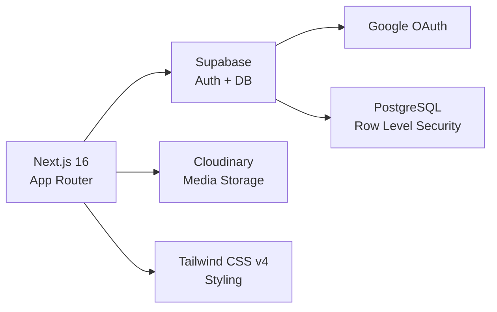
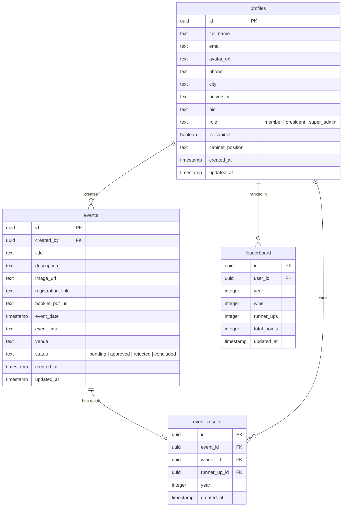
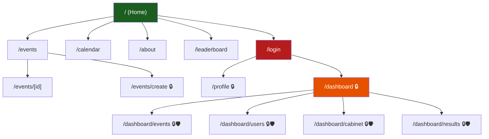

# 🏆 All Pakistan Quiz Society (APQS) — Development Plan

---

## Project Overview

| Detail | Value |
|---|---|
| **Framework** | Next.js 16.3.6 (App Router, TypeScript) |
| **Styling** | Tailwind CSS v4 (already installed) |
| **Auth & Database** | Supabase (Google OAuth) |
| **File Storage** | Cloudinary (images + PDFs) |
| **Theme** | Dark green (#1B5E20) brand palette, dark/light mode toggle |
| **Calendar** | Full interactive monthly grid (Google Calendar style) |
| **Leaderboard** | All-time + yearly leaderboards |

---

## Tech Stack Summary



---

## User Roles & Permissions

| Role | Permissions |
|---|---|
| **Visitor** (unauthenticated) | Browse home, events list, calendar, about/cabinet, leaderboard |
| **Member** (authenticated) | All visitor + edit profile, upload avatar, create events (pending approval) |
| **President** (admin) | All member + approve/reject events, declare winners, manage cabinet, assign roles |
| **Super Admin** | All president + change president, manage all roles, full system oversight |

---

## Database Schema



---

## Site Map



> 🔒 = Requires authentication | 🛡️ = Requires admin/super_admin role

---

## Development Phases

Each phase is a self-contained unit. After completing each phase, we test it, verify it works, and then move on.

---

### Phase 1 — Foundation & Design System
> **Goal:** Project scaffold, design tokens, shared layout, dark/light mode toggle

**Tasks:**
1. Install dependencies: `@supabase/supabase-js`, `@supabase/ssr`, `next-cloudinary`, `lucide-react` (icons)
2. Set up Tailwind CSS v4 theme with APQS brand palette:
   - Primary: `#1B5E20` (deep green), `#2E7D32` (medium green), `#4CAF50` (bright green)
   - Accent: `#FFD600` (gold for highlights/winners)
   - Neutral dark: `#0A0F0D`, `#1A1F1D`, `#2A2F2D`
   - Neutral light: `#FAFAFA`, `#F5F5F5`, `#E0E0E0`
3. Create the root layout with:
   - Dark/light mode toggle (using `next-themes` or custom context)
   - Google Font: `Inter` (body) + `Outfit` (headings)
4. Build shared components:
   - **Navbar** — Logo (header_icon.jpeg), nav links, dark/light toggle, Login/Profile button
   - **Footer** — Branding, social links, copyright
   - **Container** — Max-width wrapper
5. Create the **Home page** (`/`) with:
   - Hero section with society branding and tagline
   - Featured upcoming events (placeholder cards)
   - Quick links to Calendar, About, Leaderboard
6. Set `tab_icon.jpeg` as favicon/tab icon in metadata

**Deliverable:** A visually stunning landing page with responsive navbar, footer, and dark/light mode toggle. No backend yet.

**Test:** `npm run dev` → navigate `/` → verify layout, responsiveness, mode toggle

---

### Phase 2 — Supabase Auth & Google Login
> **Goal:** User authentication with Google OAuth via Supabase

**Tasks:**
1. Set up Supabase project (user provides project URL + anon key)
2. Create `.env.local` with Supabase credentials
3. Configure Supabase SSR client helpers:
   - `lib/supabase/server.ts` — server-side client
   - `lib/supabase/client.ts` — browser client
   - `lib/supabase/middleware.ts` — session refresh middleware
4. Create `middleware.ts` at project root for session management
5. Build `/login` page:
   - "Sign in with Google" button (branded, animated)
   - Redirect to home on success
6. Create `/auth/callback` API route to handle OAuth callback
7. Create Supabase SQL migration for `profiles` table:
   - Auto-create profile row on new user sign-up (via Supabase trigger)
   - Default role: `member`
8. Update Navbar to show user avatar + dropdown (Profile, Dashboard, Logout) when authenticated

**Deliverable:** Working Google OAuth login/logout. Profile auto-created on first login.

**Test:** Click "Sign in with Google" → authenticate → see avatar in navbar → logout → verify session cleared

---

### Phase 3 — User Profiles
> **Goal:** Users can view and edit their profile with avatar upload

**Tasks:**
1. Configure Cloudinary:
   - Add `NEXT_PUBLIC_CLOUDINARY_CLOUD_NAME` and `CLOUDINARY_API_KEY`/`SECRET` to `.env.local`
   - Configure `next.config.ts` to allow Cloudinary image domains
2. Create `/profile` page (protected route):
   - Display current profile data (name, email, avatar, phone, city, university, bio)
   - Edit mode with inline form
   - Avatar upload via Cloudinary unsigned upload widget
3. Create API routes:
   - `GET /api/profile` — fetch current user profile
   - `PUT /api/profile` — update profile fields
   - `POST /api/upload` — handle Cloudinary upload signing
4. Build reusable `<ProfileCard>` component (used later on cabinet page)

**Deliverable:** Users can upload an avatar, fill in contact details, and save their profile.

**Test:** Login → navigate `/profile` → upload image → edit fields → save → refresh → verify data persists

---

### Phase 4 — Events System (CRUD + Approval)
> **Goal:** Members create events, admins approve them, visitors browse approved events

**Tasks:**
1. Create Supabase SQL migration for `events` table with RLS policies:
   - Members can INSERT (status = `pending`)
   - Only admin/super_admin can UPDATE status
   - Everyone can SELECT where status = `approved` or `concluded`
   - Creator can SELECT their own pending/rejected events
2. Create API routes:
   - `GET /api/events` — list approved events (public) with pagination
   - `GET /api/events/[id]` — single event detail (public if approved)
   - `POST /api/events` — create event (auth required)
   - `PUT /api/events/[id]` — update event (creator or admin)
   - `DELETE /api/events/[id]` — delete event (creator or admin)
   - `PATCH /api/events/[id]/status` — approve/reject (admin only)
3. Build `/events` page:
   - Grid/list of approved events with cards showing image, title, date, status badge
   - Search and filter (by date, status)
4. Build `/events/[id]` page:
   - Full event detail: hero image, title, description, date/time, venue
   - Registration link button
   - Download booklet PDF button
   - Creator info
5. Build `/events/create` page (protected):
   - Form: title, description, image upload (Cloudinary), registration link, booklet PDF upload (Cloudinary), date, time, venue
   - Submit → status = `pending` → redirect to events list
6. Build event card component with hover animations and status badges

**Deliverable:** Full event lifecycle — create → pending → approved → visible to public.

**Test:**
- Login → create event → verify status "pending"
- Login as admin → approve event → verify it appears on public `/events`
- Visit `/events/[id]` without login → verify all details visible

---

### Phase 5 — Event Calendar
> **Goal:** Interactive monthly calendar grid showing approved events

**Tasks:**
1. Build `/calendar` page with custom calendar grid:
   - Full monthly view with day cells
   - Events displayed as colored dots/badges on their dates
   - Click a date → modal/sidebar shows events on that day
   - Navigate between months (prev/next arrows)
   - "Today" button to return to current month
2. Create API route:
   - `GET /api/events/calendar?month=9&year=2026` — returns events for given month
3. Mobile responsive: switch to agenda/list view on small screens
4. Color-code events by status:
   - 🟢 Green dot = upcoming approved event
   - 🟡 Gold dot = happening today
   - ⚫ Gray dot = concluded
5. Add subtle animations: fade-in for events, slide for month transitions

**Deliverable:** A Google Calendar-style interactive monthly view populated with real event data.

**Test:**
- Navigate `/calendar` → see current month with events
- Click date with events → verify modal shows event details
- Navigate months → verify events update
- Test on mobile → verify agenda view

---

### Phase 6 — Admin Dashboard
> **Goal:** Admin panel for managing events, users, and cabinet

**Tasks:**
1. Create `/dashboard` layout (protected, admin-only):
   - Sidebar navigation: Overview, Events, Users, Cabinet, Results
   - Stats cards: total events, pending approvals, total members, active cabinet
2. Build `/dashboard/events`:
   - Table of all events (all statuses) with bulk actions
   - Approve/Reject buttons with confirmation modals
   - Filter by status (pending/approved/rejected/concluded)
3. Build `/dashboard/users`:
   - Table of all registered users
   - Role management: change user role (member → president, etc.)
   - Only super_admin can assign president role
   - President can assign member roles
4. Build `/dashboard/cabinet`:
   - Select members for cabinet display
   - Assign cabinet positions (President, VP, General Secretary, etc.)
   - Toggle cabinet visibility on/off
5. Create API routes:
   - `GET /api/admin/events` — all events for admin
   - `GET /api/admin/users` — all users with roles
   - `PUT /api/admin/users/[id]/role` — change user role
   - `PUT /api/admin/users/[id]/cabinet` — toggle cabinet membership + set position
6. Implement RLS policies enforcing admin-only access

**Deliverable:** Fully functional admin dashboard with event approval workflow and user/role management.

**Test:**
- Login as admin → navigate `/dashboard` → see stats
- Approve a pending event → verify it appears on public events page
- Change a user's role → verify their permissions change
- Select users for cabinet → verify they appear with positions

---

### Phase 7 — About & Cabinet Page
> **Goal:** Public about page showing society info and current cabinet members

**Tasks:**
1. Build `/about` page:
   - Society mission statement and history section
   - Animated stats (total events, total members, years active)
   - Current cabinet section:
     - Grid of `<ProfileCard>` components for each cabinet member
     - Show name, avatar, position, contact
     - Hover effect: flip/glow animation
   - Call-to-action: "Join the Society" → login page
2. Create API route:
   - `GET /api/cabinet` — returns current cabinet members (public)
3. Add section transitions and scroll-reveal animations
4. SEO metadata for the about page

**Deliverable:** A visually polished about page that dynamically shows admin-selected cabinet members.

**Test:**
- Navigate `/about` without login → see cabinet members
- Admin adds/removes cabinet member → refresh about page → verify update
- Check mobile responsiveness

---

### Phase 8 — Event Results & Winner Declaration
> **Goal:** Admins declare winners after events conclude, results displayed publicly

**Tasks:**
1. Create Supabase SQL migration for `event_results` table
2. Build result declaration flow in admin dashboard:
   - `/dashboard/results` page
   - Select a concluded event → search and pick winner + runner-up from registered users
   - Submit results → event status changes to `concluded`
3. Update `/events/[id]` page:
   - If event is concluded, show winner and runner-up with trophy icons
   - Animated reveal for winner section
4. Create API routes:
   - `POST /api/admin/events/[id]/results` — declare winner/runner-up
   - `GET /api/events/[id]/results` — get event results (public)
5. Show recent winners on the home page hero section

**Deliverable:** Complete event lifecycle from creation → approval → conclusion → winner declaration.

**Test:**
- Admin concludes event → declares winner/runner-up → verify results on event detail page
- Home page shows latest winners

---

### Phase 9 — Leaderboard System
> **Goal:** Points-based leaderboard with yearly + all-time rankings

**Tasks:**
1. Create Supabase SQL migration for `leaderboard` table + auto-update trigger:
   - When event_results are inserted → update leaderboard
   - Points system: Win = 10 pts, Runner-up = 5 pts
2. Build `/leaderboard` page:
   - **All-time leaderboard**: ranked table with rank, avatar, name, total wins, runner-ups, total points
   - **Yearly leaderboard**: dropdown to select year, shows that year's rankings
   - Top 3 podium with gold/silver/bronze styling and animations
   - Champion badge for #1 ("Best Quizzer of the Year")
3. Create API routes:
   - `GET /api/leaderboard?year=all` — all-time rankings
   - `GET /api/leaderboard?year=2026` — yearly rankings
4. Add leaderboard preview widget to home page

**Deliverable:** Fully dynamic leaderboard with podium, yearly filtering, and auto-calculated points.

**Test:**
- Declare multiple event results → verify leaderboard updates automatically
- Switch between years → verify correct rankings
- Verify champion badge on #1 ranked player

---

### Phase 10 — Polish, SEO & Deployment Prep
> **Goal:** Final polish, performance optimization, SEO, and deployment readiness

**Tasks:**
1. **SEO & Metadata:**
   - Dynamic `<title>` and `<meta>` for every page
   - Open Graph images (auto-generated or static)
   - `robots.txt` and `sitemap.xml`
2. **Performance:**
   - Image optimization with `next/image` + Cloudinary transformations
   - Loading skeletons for all data-fetching pages
   - Error boundaries and 404/500 pages
3. **Animations & Micro-interactions:**
   - Page transition animations
   - Scroll-reveal effects on home/about pages
   - Button hover/click feedback
   - Toast notifications for actions (event created, profile saved, etc.)
4. **Accessibility:**
   - ARIA labels on interactive elements
   - Keyboard navigation support
   - Color contrast compliance
5. **Security hardening:**
   - Verify all RLS policies
   - Rate limiting on API routes
   - Input validation/sanitization
6. **Final testing:**
   - Full E2E walkthrough of all user flows
   - Mobile responsiveness audit
   - Cross-browser testing

**Deliverable:** Production-ready, polished website.

**Test:** Full regression test of all features across devices and browsers.

---

## Implementation Order — Quick Reference

| Phase | Name | Key Deliverable | Dependencies |
|---|---|---|---|
| **1** | Foundation & Design System | Stunning landing page + layout | None |
| **2** | Supabase Auth | Google OAuth login/logout | Phase 1 |
| **3** | User Profiles | Profile CRUD + avatar upload | Phase 2 |
| **4** | Events System | Event CRUD + approval workflow | Phase 2, 3 |
| **5** | Event Calendar | Interactive monthly calendar | Phase 4 |
| **6** | Admin Dashboard | Event/user/cabinet management | Phase 4 |
| **7** | About & Cabinet | Public cabinet display | Phase 6 |
| **8** | Event Results | Winner declaration | Phase 4, 6 |
| **9** | Leaderboard | Points & rankings | Phase 8 |
| **10** | Polish & Deploy | Production-ready | All phases |

---

## Environment Variables Required

```env
# Supabase
NEXT_PUBLIC_SUPABASE_URL=your_supabase_url
NEXT_PUBLIC_SUPABASE_ANON_KEY=your_anon_key
SUPABASE_SERVICE_ROLE_KEY=your_service_role_key

# Cloudinary
NEXT_PUBLIC_CLOUDINARY_CLOUD_NAME=your_cloud_name
CLOUDINARY_API_KEY=your_api_key
CLOUDINARY_API_SECRET=your_api_secret

# App
NEXT_PUBLIC_APP_URL=http://localhost:3000
```

---

## Folder Structure (Target)

```
app/
├── (public)/              # Public routes group
│   ├── page.tsx           # Home
│   ├── events/
│   │   ├── page.tsx       # Events list
│   │   └── [id]/
│   │       └── page.tsx   # Event detail
│   ├── calendar/
│   │   └── page.tsx       # Calendar view
│   ├── about/
│   │   └── page.tsx       # About + Cabinet
│   ├── leaderboard/
│   │   └── page.tsx       # Leaderboard
│   └── login/
│       └── page.tsx       # Login page
├── (protected)/           # Auth-required routes
│   ├── profile/
│   │   └── page.tsx       # User profile
│   ├── events/
│   │   └── create/
│   │       └── page.tsx   # Create event
│   └── dashboard/         # Admin panel
│       ├── layout.tsx     # Dashboard sidebar layout
│       ├── page.tsx       # Dashboard overview
│       ├── events/
│       │   └── page.tsx   # Manage events
│       ├── users/
│       │   └── page.tsx   # Manage users/roles
│       ├── cabinet/
│       │   └── page.tsx   # Manage cabinet
│       └── results/
│           └── page.tsx   # Declare winners
├── api/
│   ├── auth/
│   │   └── callback/
│   │       └── route.ts
│   ├── profile/
│   │   └── route.ts
│   ├── events/
│   │   ├── route.ts
│   │   ├── [id]/
│   │   │   ├── route.ts
│   │   │   ├── status/
│   │   │   │   └── route.ts
│   │   │   └── results/
│   │   │       └── route.ts
│   │   └── calendar/
│   │       └── route.ts
│   ├── cabinet/
│   │   └── route.ts
│   ├── leaderboard/
│   │   └── route.ts
│   ├── upload/
│   │   └── route.ts
│   └── admin/
│       ├── events/
│       │   └── route.ts
│       └── users/
│           ├── route.ts
│           └── [id]/
│               ├── role/
│               │   └── route.ts
│               └── cabinet/
│                   └── route.ts
├── auth/
│   └── callback/
│       └── route.ts
├── components/
│   ├── ui/                # Reusable UI primitives
│   │   ├── Button.tsx
│   │   ├── Card.tsx
│   │   ├── Modal.tsx
│   │   ├── Input.tsx
│   │   ├── Badge.tsx
│   │   ├── Skeleton.tsx
│   │   └── Toast.tsx
│   ├── layout/
│   │   ├── Navbar.tsx
│   │   ├── Footer.tsx
│   │   ├── Sidebar.tsx
│   │   └── ThemeToggle.tsx
│   ├── events/
│   │   ├── EventCard.tsx
│   │   ├── EventForm.tsx
│   │   └── EventCalendar.tsx
│   ├── profile/
│   │   ├── ProfileCard.tsx
│   │   └── ProfileForm.tsx
│   └── leaderboard/
│       ├── Podium.tsx
│       └── RankTable.tsx
├── lib/
│   ├── supabase/
│   │   ├── server.ts
│   │   ├── client.ts
│   │   └── middleware.ts
│   ├── cloudinary.ts
│   ├── utils.ts
│   └── types.ts
├── layout.tsx
├── globals.css
└── middleware.ts
```

---

> [!IMPORTANT]
> **Before starting Phase 2**, you will need to:
> 1. Create a Supabase project at [supabase.com](https://supabase.com)
> 2. Enable Google Auth provider in Supabase → Authentication → Providers
> 3. Create a Cloudinary account at [cloudinary.com](https://cloudinary.com)
> 4. Provide the environment variable values listed above

---

> [!TIP]
> **Ready to begin?** Say **"Start Phase 1"** and I'll implement the foundation, design system, landing page, navbar, footer, and dark/light mode toggle — all testable immediately.
